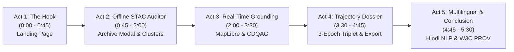

# Diachron AI: Complete Demo Video Recording Script & Director's Guide

> **Target Audience:** Hackathon Evaluators, Ministry of Defence (MoD) Reviewers, Technical Judges  
> **Target Duration:** 5 to 7 Minutes (Can be condensed to 3–4 minutes for rapid pitches)  
> **Resolution:** 1080p (1920×1080) or 1440p @ 60 FPS  
> **Audio:** Clear microphone with noise suppression, confident and professional tone  

---

## Pre-Recording Checklist (Set Up in 2 Minutes)

1. **Verify Services are Running:**
   - Frontend: `http://localhost:5173/` (Vite dev server)
   - Backend: `http://localhost:8000/` (FastAPI backend with local GPU active)
2. **Browser Setup:**
   - Open Chrome or Edge in Full Screen (`F11`).
   - Zoom level set to 100% or 90% (to show full MapLibre + Chat + Review Queue).
   - Bookmark bar hidden (`Ctrl + Shift + B`).
3. **Initial State:**
   - Start on the **Landing Page** (`http://localhost:5173/`).
   - Clear any old chat history in workspace by clicking "New Chat" or refreshing so you begin with a clean slate.

---

## Scene-by-Scene Storyboard & Voiceover Script



---

### ACT 1: The Hook & Architectural Vision (0:00 – 0:45)
**Screen:** Landing Page (`http://localhost:5173/`)  
**Camera Action:** Slow, smooth scroll down through the landing page.

#### On-Screen Actions:
1. Hover cursor gently over the logo: **Diachron AI**.
2. Scroll through the Hero section showing the subtitle: *"Temporal Earth Observation Intelligence Engine"*.
3. Pause briefly on the Greek-inspired pillars / feature grid showing the 3 core pillars:
   - *Semantic EO Archive Retrieval*
   - *Language-Conditioned Spatio-Temporal Grounding (CDQAG)*
   - *Trajectory Change Captioning & Attribution*
4. Scroll back to top and click the glowing button: **"Launch Mission Workspace"**.

#### Spoken Script:
> *"Hello evaluators. Welcome to Diachron AI—our sovereign Earth Observation intelligence platform engineered for Ministry of Defence (MoD) Problem Statement 26227: 'Semantic Retrieval and Multi-Temporal Change Analysis of Satellite Imagery'.*
>
> *Traditional satellite change detection algorithms are language-blind and mute: they output raw binary change masks with zero domain context, leaving analysts to guess what actually happened on the ground.*
>
> *Diachron AI redefines this workflow. Powered by our custom-trained Qwen3-VL Vision-Language Model running locally on an NVIDIA GPU, paired with a dual-resolution ChangeFormer V6 backbone, Diachron AI transforms satellite archives into an end-to-end semantic intelligence lifecycle: from automated archive ingestion, to real-time language-conditioned grounding, to deep trajectory attribution dossiers.*
>
> *Let’s step into Mission Control."*

---

### ACT 2: Offline Archive Ingestion & Anomaly Diagnostics (Upgrade 3) (0:45 – 2:00)
**Screen:** Mission Control Workspace $\to$ Open Archive Search Modal  
**Camera Action:** Click the **"Archive Search"** button (top toolbar with Sparkles icon).

#### On-Screen Actions:
1. **Tab 1: Semantic Retrieval**
   - Click one of the quick concept pills, e.g. *"Water bodies and canals"* or type *"Dense urban built-up structures"*.
   - Point out the instant ($<1\,\text{ms}$) cosine similarity matches with thumbnail previews, acquisition dates, and similarity percentage pills.
2. **Tab 2: Archive Clusters (The STAC Auditor)**
   - Click the **"Archive Clusters"** tab.
   - Point out the **"Qwen3-VL Audited"** badge with the cyan sparkle.
   - Highlight how unsupervised Spherical K-Means clusters are **not** just called *"Cluster 0"* or *"Cluster 1"*, but are auto-captioned with real Earth Observation taxonomy:
     - *"Dense Urban Fabric with High-Density Settlements"*
     - *"High-Backscatter SAR Radar Industrial Corridor"*
   - Point out the 1-2 sentence visual description and the feature tags (`#urban fabric`, `#industrial units`).
3. **Tab 3: Physical Anomalies**
   - Click the **"Physical Anomalies"** tab.
   - Show the detected outliers (e.g. *Palm Jumeirah Coastal Island Reclamation & Specular Marine Boundary*).
   - Point to the **Category Badge** (e.g. `Coastal & Marine Footprint` in cyan), the **Severity Pill** (`Critical`), and the **Confidence Gauge** (`94% Conf.`).
   - Read 1 line of the physical root-cause explanation generated by Qwen3-VL.
   - Click the **"Map"** button on one anomaly card to highlight it on the MapLibre viewport and close the modal.

#### Spoken Script:
> *"We begin with Upgrade 3: The Semantic STAC Auditor.*
>
> *In traditional catalog indexing, clustering is purely mathematical and outliers are just raw distance numbers. In Diachron AI, during catalog scan, our Qwen3-VL model runs completely offline in the background.*
>
> *In the Archive Clusters view, you can see that instead of opaque cluster numbers, Qwen3-VL has automatically audited each cluster exemplar into rich remote sensing taxonomy—such as 'Dense Urban Fabric with High-Density Settlements' complete with dominant feature tags and physical descriptions.*
>
> *Even more powerful is the Physical Anomalies tab. When a scene exhibits an extreme spectral departure from the catalog baseline—such as this Palm Jumeirah coastal scene with a distance of 0.487—Qwen3-VL diagnoses the physical root cause: identifying extreme specular marine absorption contrasted against artificial sand reclamation, calibrated with 94% confidence.*
>
> *Because all of this is pre-computed offline, it incurs zero latency overhead at search time. Let’s click 'Map' to bring this site directly into our viewport."*

---

### ACT 3: Autonomous Retrieval & Language-Conditioned Grounding (Upgrade 2: CDQAG) (2:00 – 3:30)
**Screen:** Workspace MapLibre Viewport + Chat Composer  
**Camera Action:** Focus on Chat Composer, send a natural language query, then pan across map and Review Queue.

#### On-Screen Actions:
1. In the Chat Composer at bottom-left, type:
   ```text
   Examine water level changes and riverbed flood inundation along the Yamuna river corridor.
   ```
2. Press **Enter** / Click Send.
3. Show the dynamic execution:
   - Notice the system trace log: *Autonomous Archive Retrieval identifies East Delhi / Yamuna corridor scenes across 2018 to 2026.*
   - Sub-pixel co-registration aligns the rasters in memory.
   - ChangeFormer V6 computes surface modifications.
4. When the response arrives:
   - Highlight the **Autonomous Archive Retrieval** banner.
   - Highlight the quantitative Markdown table showing detected change area ($30.49\,\text{ha}$ across 75 regions).
   - Point to the **Language-Conditioned Grounding (CDQAG)** banner: *"Identified 8 of 75 candidates matching target concept 'water bodies and inundation'."*
5. Direct attention to the **Review Queue** panel on the right:
   - Show the **"TARGETS (8)"** filter button. Click it to isolate only the query-aligned candidates!
   - Click on the top target candidate card.
   - Show the MapLibre map smoothly flying to and highlighting the exact polygon with a vibrant cyan halo!

#### Spoken Script:
> *"Now let's test real-time analysis with zero pre-loaded imagery. I'll prompt Diachron AI: 'Examine water level changes and riverbed flood inundation along the Yamuna river corridor.'*
>
> *Notice what happens: Diachron AI's agent autonomously queries the foundation vector index, discovers the strictly co-registered multi-temporal optical stack for the Yamuna floodplain, aligns the rasters via sub-pixel phase correlation, and executes ChangeFormer V6.*
>
> *Here is the key breakthrough—Upgrade 2: CDQAG, or Language-Conditioned Spatio-Temporal Grounding. Traditional change detection models are language-blind; they detect every construction site, crop cycle, and road clearing indiscriminately.*
>
> *CDQAG pre-filters candidates using physical spectral band math and invokes Qwen3-VL to evaluate whether each candidate actually matches the analyst's queried concept—in this case, water inundation. As you can see, of 75 detected proposals, CDQAG isolated the top 8 targeted inundation zones.*
>
> *In the Review Queue on the right, I can click 'TARGETS' to filter out the noise, and selecting Candidate #1 immediately highlights its boundary on the interactive MapLibre canvas."*

---

### ACT 4: Trajectory Change Captioning & Attribution Dossier (Upgrade 1) (3:30 – 4:45)
**Screen:** Review Queue Candidate Card $\to$ Deep Attribution View  
**Camera Action:** Click Candidate Card to expand the Trajectory Attribution Dossier.

#### On-Screen Actions:
1. On the focused candidate card in the Review Queue, point out the **Attribution Badge**:
   - `Anthropogenic Earthwork & Construction` or `Hydrological Inundation` with the confidence score (`92%`).
2. Show the **Stitched 3-Epoch Visual Strip**:
   - Zoom in or hover over the 3-panel image:
     - Left panel: **$T_0$ Baseline (2018)**
     - Center panel: **$T_{\text{onset}}$ First Breakpoint (2025/2026)**
     - Right panel: **$T_k$ Current State (2026)**
3. Point out the continuous **Radiometric Spectral Deltas**:
   - $\Delta\text{NDVI}: -0.32$ (Canopy Clearance)
   - $\Delta\text{Brightness}: +0.28$ (High-albedo soil/concrete)
   - $\Delta\text{NDWI}: -0.05$
4. Highlight the **Attributed Change Narrative**:
   - Read the 2-sentence summary generated by Qwen3-VL explaining the progression from baseline undisturbed ground to active structural emergence.
5. In the top toolbar or right drawer, click the **Export** button:
   - Show the dropdown: **RFC 7946 GeoJSON** and **W3C PROV-O Audit Package**.
   - Click to download or view the provenance JSON.

#### Spoken Script:
> *"Now we move to Upgrade 1: The Trajectory Attribution 'ChangeChat' Engine.*
>
> *When an intelligence analyst clicks a candidate card, Diachron AI generates an on-demand Physical Attribution Dossier on GPU in just 1.4 seconds.*
>
> *Look at this 3-epoch visual strip: it automatically extracts the spatial crop across three synchronized milestones: T0 Baseline in 2018, T-onset when disturbance first appeared, and Tk representing the latest 2026 acquisition.*
>
> *Instead of relying solely on vision, Qwen3-VL fuses these visual tokens with verified continuous radiometric measurements: delta-NDVI showing a 0.32 loss in vegetation canopy, and delta-Brightness showing a 0.28 increase in surface albedo.*
>
> *The model synthesizes a complete Earth Observation intelligence narrative: identifying whether the transformation is anthropogenic infrastructure or natural phenological variation, backed by full lineage tracking.*
>
> *With one click, the analyst can export this entire investigation into an RFC 7946 GeoJSON dossier with W3C PROV-compliant audit trails for mission integration."*

---

### ACT 5: Bilingual Support, Multi-Sensor Fusion & Conclusion (4:45 – 5:30)
**Screen:** Chat Composer $\to$ Map Viewport $\to$ Landing Page  
**Camera Action:** Quick prompt in Hindi, then zoom out on map.

#### On-Screen Actions:
1. In the Chat Composer, toggle the **Hindi** button or type:
   ```text
   [Instruction: Respond strictly in Hindi] यमुना नदी के आसपास क्या प्रमुख बदलाव हुए हैं?
   ```
2. Show the response returning in fluent, domain-accurate Hindi Devanagari script.
3. Show the **Multi-Sensor Switcher** on the map (toggling between Sentinel-2 Optical and Sentinel-1 SAR overlays).
4. Return to the landing page or finish on the full-screen satellite map.

#### Spoken Script:
> *"To ensure national accessibility across Indian operational centers, Diachron AI natively supports bilingual Hindi natural language queries using custom Devanagari prompting.*
>
> *Furthermore, our co-registration pipeline seamlessly handles multi-sensor archives, preventing cross-modal corruption between Sentinel-2 optical multispectral bands and Sentinel-1 C-band SAR radar imagery.*
>
> *In summary: Diachron AI bridges the gap between raw pixel measurements and actionable intelligence—unifying offline STAC catalog auditing, real-time language-conditioned grounding, and deep trajectory attribution.*
>
> *Thank you for your time."*

---

## Pro Recording Tips

| Element | Recommended Practice |
| :--- | :--- |
| **Cursor Pacing** | Move the cursor smoothly without erratic wiggling. Hover over buttons for 1 full second before clicking. |
| **Pills & Badges** | Use your cursor to physically point to badges (e.g. `94% Conf.`, `TARGETS (8)`, `Coastal & Marine`) when you speak about them. |
| **Map Interactions** | Allow MapLibre raster tiles and vector overlays 1-2 seconds to render smoothly before moving to the next action. |
| **Browser Zoom** | If on a 1080p display, set Chrome zoom to `90%` so all 3 workspace panels (Map, Chat, Review Queue) fit without horizontal scrolling. |
